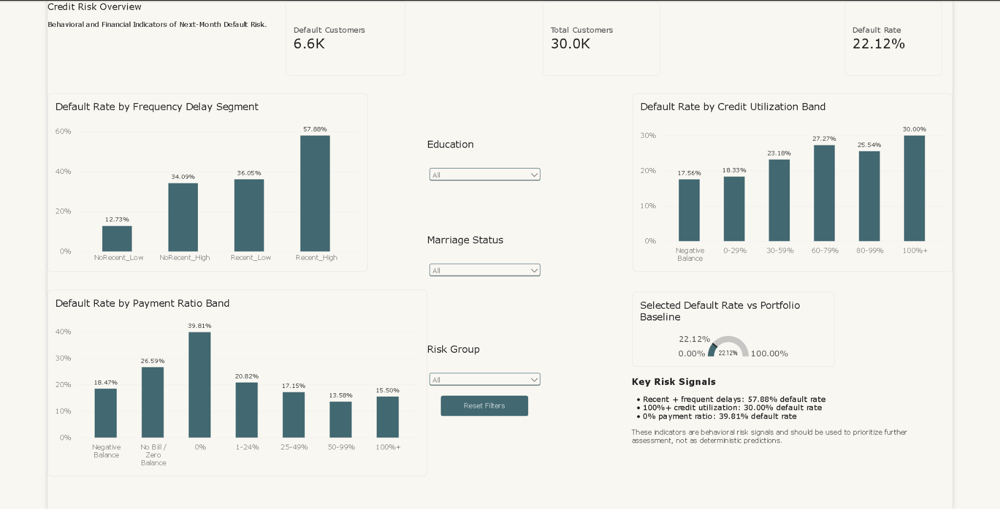

# Credit Risk Analytics

End-to-end data analytics project focused on identifying behavioral and financial indicators associated with next-month credit card default.

The project combines **SQL Server, Python, and Power BI** to validate the data, engineer risk features, analyze customer behavior, and communicate the most relevant findings through an interactive dashboard.

---

## Project Objective

The main business objective is to identify patterns associated with higher default risk and create reusable customer-risk features that can support monitoring and prioritization.

The analysis focuses on four key dimensions:

- **Payment delay frequency**
- **Payment delay severity**
- **Recent payment behavior**
- **Credit utilization and repayment behavior**

The project does **not** treat these indicators as deterministic predictors. They are interpreted as behavioral risk signals that can support further assessment.

---

## Dataset

- **30,000 customers**
- **25 original variables**
- Target variable: `DEFAULT_NEXT_MONTH`
  - `1` = customer defaulted in the next month
  - `0` = customer did not default

Main groups of variables include:

- Credit limit
- Demographic attributes
- Payment status history
- Monthly bill amounts
- Monthly payment amounts
- Default status

---

## Tools Used

- **SQL Server**
  - Data validation
  - Feature engineering
  - CTEs
  - CASE expressions
  - Aggregations
  - Views

- **Python**
  - `pandas`
  - `numpy`
  - `pyodbc`
  - `matplotlib`
  - Exploratory data analysis
  - Extreme-value review
  - Behavioral segmentation

- **Power BI**
  - DAX measures
  - Calculated columns
  - KPI cards
  - Interactive slicers
  - Gauge visualization
  - Executive dashboard

---

## Project Workflow

```text
Raw Credit Risk Data
        ↓
SQL Server Validation
        ↓
SQL Feature Engineering
        ↓
vw_CustomerRiskFeatures
        ↓
Python Exploratory Analysis
        ↓
Power BI Dashboard
        ↓
Business Insights
```

---

## SQL Analysis

SQL was used to validate the dataset and build reusable analytical features.

### Main SQL Features

#### `DelayedMonths`
Counts the number of observed periods with a confirmed payment delay.

```sql
CASE WHEN PAY_0 >= 1 THEN 1 ELSE 0 END +
CASE WHEN PAY_2 >= 1 THEN 1 ELSE 0 END +
CASE WHEN PAY_3 >= 1 THEN 1 ELSE 0 END +
CASE WHEN PAY_4 >= 1 THEN 1 ELSE 0 END +
CASE WHEN PAY_5 >= 1 THEN 1 ELSE 0 END +
CASE WHEN PAY_6 >= 1 THEN 1 ELSE 0 END
```

#### `MaxDelay`
Represents the maximum confirmed delay level observed across the payment history.

#### `CreditUtilization`

```text
BILL_AMT1 / LIMIT_BAL × 100
```

#### `PaymentRatio`

```text
PAY_AMT1 / BILL_AMT1 × 100
```

`PaymentRatio` is only calculated when `BILL_AMT1 > 0`.

#### `RiskGroup`

Customers were grouped into:

- `HighUtilization_LowPayment`
- `OtherValidBehavior`
- `NotComparable`

The final SQL view:

```sql
dbo.vw_CustomerRiskFeatures
```

was used as the reusable analytical layer for both Python and Power BI.

---

## Python Exploratory Analysis

Python was used to validate engineered features, inspect extreme values, and explore the relationship between payment behavior and default risk.

### Extreme Value Review

Extreme values in `PaymentRatio` and `CreditUtilization` were reviewed before segmentation.

They were retained because they were mathematically consistent with the underlying balances and payments and could represent valid customer behavior.

---

## Key Findings

### 1. Baseline Default Rate

- Total customers: **30,000**
- Default customers: **6,636**
- Overall default rate: **22.12%**

---

### 2. Delay Frequency

Default risk increased substantially as customers accumulated more delayed months.

- No confirmed delayed months: **11.71%**
- Delays in all six observed months: **70.32%**

Repeated payment delays were one of the strongest behavioral risk indicators observed in the analysis.

---

### 3. Recent Payment Delay

Customers with a recent confirmed delay showed a much higher default rate.

- No recent confirmed delay: **13.83%**
- Recent confirmed delay: **50.29%**

---

### 4. Combined Recency and Frequency

Combining recent delay status with historical delay frequency created clearer risk segmentation.

| Segment | Default Rate |
|---|---:|
| NoRecent_Low | 12.73% |
| NoRecent_High | 34.09% |
| Recent_Low | 36.05% |
| Recent_High | 57.88% |

The `Recent_High` segment showed the highest default rate.

---

### 5. Credit Utilization

Default risk generally increased as credit utilization rose.

| Credit Utilization Band | Default Rate |
|---|---:|
| Negative Balance | 17.56% |
| 0-29% | 18.33% |
| 30-59% | 23.18% |
| 60-79% | 27.27% |
| 80-99% | 25.54% |
| 100%+ | 30.00% |

The relationship was not perfectly linear, but customers above 100% utilization showed the highest rate.

---

### 6. Payment Ratio

Customers who paid a larger proportion of their billed balance generally showed lower default risk.

| Payment Ratio Band | Default Rate |
|---|---:|
| Negative Balance | 18.47% |
| No Bill / Zero Balance | 26.59% |
| 0% | 39.81% |
| 1-24% | 20.82% |
| 25-49% | 17.15% |
| 50-99% | 13.58% |
| 100%+ | 15.50% |

The `0%` payment group showed the highest default rate.

---

## Power BI Dashboard

The Power BI dashboard was designed as a single-page executive overview.

### KPI Cards

- Total Customers
- Default Customers
- Default Rate

### Main Visuals

- Default Rate by Frequency Delay Segment
- Default Rate by Credit Utilization Band
- Default Rate by Payment Ratio Band

### Interactive Filters

- Education
- Marriage Status
- Risk Group

### Additional Features

- `Reset Filters` button
- Selected Default Rate vs Portfolio Baseline gauge
- Key Risk Signals summary

The dashboard allows users to compare filtered customer segments against the overall portfolio default rate of **22.12%**.

---

## Key Risk Signals

- **Recent + frequent delays:** 57.88% default rate
- **100%+ credit utilization:** 30.00% default rate
- **0% payment ratio:** 39.81% default rate

These indicators are behavioral risk signals and should be used to prioritize further assessment, not as deterministic predictions.

---

## Repository Structure

```text
Credit-Risk-Analytics/
│
├── SQL/
│   └── CreditRisk_SQL.sql
│
├── Python/
│   └── Credit_Risk_Analysis.ipynb
│
├── PowerBI/
│   └── Credit Risk PBI.pbix
│
├── images/
│   └── dashboard_overview.png
│
└── README.md
```

## Dashboard Preview



---

## Business Interpretation

The analysis suggests that payment history should be a central component of credit-risk monitoring.

Customers showing:

- recent delays,
- repeated delays,
- high credit utilization,
- and low repayment ratios

may require closer monitoring or earlier intervention.

The strongest insight from the project is that combining multiple behavioral indicators provides a clearer picture of customer risk than relying on a single metric.

---

## Author

**Carlos Luis Castillo**

Data Analyst Portfolio Project  
SQL Server | Python | Power BI
